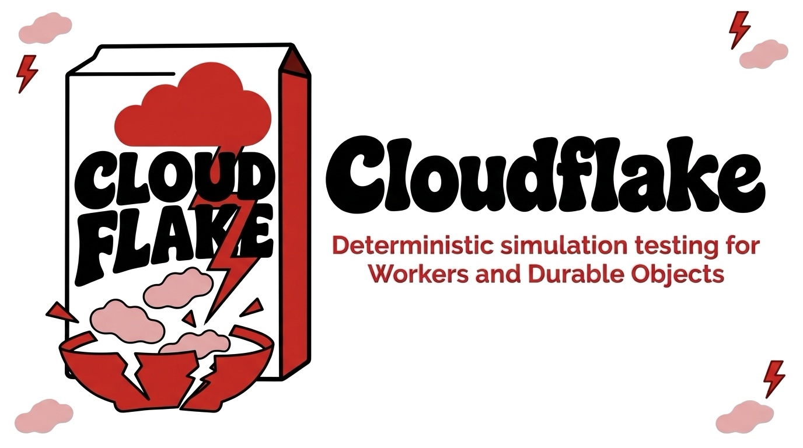

# 

Cloudflake explores failures in Cloudflare applications by varying request order, delivery, retries and eviction. Give it a scenario, a property that must hold, and a seed. A failure reports the seed, virtual time, failing operation, recent event history and original error.

The TypeScript scheduler runs in process with zero runtime dependencies. The optional Miniflare adapter runs your bundled Workers and their bindings locally in workerd. Use the same scheduling API for fast model tests and application tests.

We use Cloudflake at [Economico](https://economi.co/?utm_source=github&utm_medium=readme&utm_campaign=cloudflake) to test our Workers and Durable Objects.

## Try it

Use Node.js 24 or newer. Install with `npm install -D cloudflake`, and add a compatible Miniflare 4 or 5 for the Workers adapter. To work on Cloudflake itself, install [Vite+](https://viteplus.dev) (`vp`) and run `vp install`, `vp check`, `vp test run`, and `vp pack` from this checkout.

The following scenario tests a consumer that could receive a payment more than once. It explores a thousand schedules, checking the balance after every event.

```js
import assert from 'node:assert/strict'
import { campaign, simulate, simulatedQueue } from 'cloudflake'

async function payments(sim) {
  const posted = new Set()
  let balance = 0
  const queue = simulatedQueue(
    sim,
    'payments',
    ({ messages }) => {
      for (const { id, body } of messages) {
        if (posted.has(id)) continue
        posted.add(id)
        balance += body.amount
      }
    },
    { duplicate: 0.5 },
  )
  sim.invariant('one posting per payment', () => assert.equal(balance, 7 * posted.size))
  for (let i = 0; i < 8; i++) await queue.send({ amount: 7 })
  sim.after(1, 'all payments settled', () => assert.equal(balance, 56))
}

await campaign({ seed: 0, runs: 1000 }, payments)
// Replay one schedule with a full event trace.
await simulate({ seed: 42, onStep: console.log }, payments)
```

Remove the `posted.has(id)` guard to see a duplicate delivery violate the invariant. For replay, use the failure's seed with the same code, inputs, dependency versions and options.

## Use it with your coding agent

Cloudflake ships an [agent skill](skills/cloudflake/SKILL.md) that teaches coding agents such as Claude Code, Codex and Cursor how to write simulation tests with it: the workflow, the API, the rules that keep replay exact, recipes for common Cloudflare failures, and further reading on deterministic simulation and property-based testing.

Install it into your project with the [skills](https://skills.sh) CLI:

```sh
npx skills add economico/cloudflake
```

If Cloudflake is already a dev dependency, the skill is in the package at `node_modules/cloudflake/skills/cloudflake/SKILL.md`. `npx skills experimental_sync` links skills from installed packages into your agent's skills directory, so the skill stays in step with the installed version.

Without installing anything, point your agent at [cloudflake.dev/skill.md](https://cloudflake.dev/skill.md):

> Read https://cloudflake.dev/skill.md (or `node_modules/cloudflake/skills/cloudflake/SKILL.md`) and follow it. Write Cloudflake simulation tests for our queue consumer and Durable Objects. Check that duplicate delivery, retries and eviction cannot double-count, run a campaign of at least 500 seeds, and report any failing seed with its replay command.

Good prompts name the property that must hold ("each payment posts exactly once"), the components involved, and how many seeds to explore. Ask the agent to break the guard deliberately and confirm the test fails, so you know the test can catch the bug.

## Property-based testing with Hegel

Run `npm run test:hegel` from this checkout. The first example generates payment amounts and a Cloudflake scheduling seed, redelivers every payment, and checks the settled sum. The second uses a scripted Workers AI binding in workerd and verifies the exact D1 rows after valid, malformed and failed responses. Model quality and live provider availability require separate evaluation.

Draw workload values directly with Hegel so it can shrink individual inputs as well as the seed. Each generated case and each shrinking attempt starts with fresh state. For a permanent regression, keep the minimized inputs and the Cloudflake seed together. The seed determines delivery order for those inputs. [Runnable examples](examples/hegel.test.mjs) · [Hegel TypeScript guide](https://hegel.dev/typescript)

## Run an application

`simulateWorkers(options, deployment, scenario)` takes a factory returning normal Miniflare options, including the `workers` array for multi-Worker deployments. Each invocation creates and disposes one runtime. Omit persistence directories and remote bindings for isolated local runs. Bundle once outside a campaign, then reuse the bundle across seeds.

```js
import assert from 'node:assert/strict'
import { simulateWorkers } from 'cloudflake/miniflare'

await simulateWorkers(
  { seed: 42 },
  () => ({
    modules: true,
    scriptPath: './build/worker.mjs',
    compatibilityDate: '2026-07-01',
    durableObjects: { BOOK: { className: 'Book', useSQLite: true } },
    r2Buckets: ['FILES'],
  }),
  (sim, runtime) => {
    sim.deliver(
      'upload invoice 17',
      async () => {
        const response = await runtime.dispatchFetch('https://app.test/invoices/17', {
          method: 'PUT',
          body: 'invoice data',
        })
        assert.ok(response.ok)
      },
      { maxDelay: 50, duplicate: 1 },
    )
    sim.after(51, 'one stored invoice', async () => {
      const bucket = await runtime.getR2Bucket('FILES')
      assert.equal((await bucket.list()).objects.length, 1)
    })
  },
)
```

For a complete runnable example, run `node examples/counter.mjs` from this checkout. It redelivers increment requests to a SQLite-backed Durable Object, evicts it, and checks that each request counted once.

### Control points

#### Core DST engine (`cloudflake`)

| API                                                                                                                 | Behavior                                                                                                                                                                                                                                                |
| ------------------------------------------------------------------------------------------------------------------- | ------------------------------------------------------------------------------------------------------------------------------------------------------------------------------------------------------------------------------------------------------- |
| `sim.after(ms, label, action)`                                                                                      | Schedules a turn in virtual milliseconds and returns a cancel function. Time advances directly to the next live event. Equal-time events have seeded priorities.                                                                                        |
| `sim.onIdle(label, action)`                                                                                         | Runs once the event calendar drains to quiescence. Eliminates hardcoded settlement timestamps like `sim.after(60001, ...)`.                                                                                                                             |
| `sim.heal()` / `healAt`                                                                                             | Transitions from chaos to quiescence: drops, ambiguous failures, resets and evictions pause so retries drain cleanly before convergence checks.                                                                                                         |
| `sim.rng` / `sim.rngStream(name)` / `sim.int(limit)`                                                                | 128-bit `xoshiro128++` PRNG with isolated named sub-streams and combinators (`range`, `chance`, `pick`, `shuffle`, `weighted`, `bytes`, `uuid`, `delay`).                                                                                               |
| `sim.profile` / `swarm`                                                                                             | TigerBeetle VOPR-style swarm testing: each seed draws a randomized fault regime and latency distribution (`uniform`, `exponential`, `pareto`, `bimodal`).                                                                                               |
| `sim.deliver(label, action, policy)`                                                                                | Adds seeded latency, zero-step drops, `1..maxDuplicates` extra deliveries, and **ambiguous (gray) failures** (callee executes, then caller sees an error).                                                                                              |
| `sim.invariant(name, check)`                                                                                        | Checks a property after setup and each completed event.                                                                                                                                                                                                 |
| `sim.always` / `alwaysOrUnreachable` / `sometimes` / `reachable` / `unreachable`                                    | Antithesis-style assertion taxonomy. `sometimes` and expected `reachable`/`always` properties are aggregated across `campaign()` and fail with `PropertyCoverageFailure` if never satisfied.                                                            |
| `HistoryRecorder` & `checkLinearizability`                                                                          | Wing-Gong linearizability checker supporting definite `ok`/`fail` and `indeterminate` (ambiguous) outcomes against a pure reference model.                                                                                                              |
| `client` & `createCheckpointHub`                                                                                    | Sequential cooperative clients that pause at `checkpoint` or `sim.waitFor(...)` (with automatic deadlock detection and `x-cloudflake-client` header correlation).                                                                                       |
| `minimizeFaults(options, scenario)`                                                                                 | Delta-debugs a failing seed to find the minimal subset of injected faults that still reproduces the bug.                                                                                                                                                |
| `exploreMultiverse(options)`                                                                                        | Antithesis-style coverage-guided snapshot & branching explorer (`sim.cover()`, assertions, faults, and optional in-process V8 branch coverage).                                                                                                         |
| `probe(options, scenario)`                                                                                          | Local exploratory prober (auto-skips in CI unless `CLOUDFLAKE_PROBE=1`). Runs time-budgeted exploration, buckets failures, minimizes faults, and prints actionable guidance for coding agents.                                                          |
| `simulatedQueue`, `simulatedAlarm`, `simulatedKV`, `simulatedDurableObject`, `simulatedWaitUntil`, `simulatedFetch` | Fast in-process simulators for multi-message Queue batches + DLQ, DO alarm retries/duplicates, eventually consistent KV stale reads/TTLs, DO eviction/`abort`/`blockConcurrencyWhile`/ambiguous resets, `waitUntil` drops, and outbound `fetch` faults. |

#### Workers & Durable Objects adapter (`cloudflake/miniflare`)

| API                                                    | Behavior                                                                                                                                                                                                                                                                                                                             |
| ------------------------------------------------------ | ------------------------------------------------------------------------------------------------------------------------------------------------------------------------------------------------------------------------------------------------------------------------------------------------------------------------------------ |
| `simulateWorkers` & `campaignWorkers`                  | Run single-seed or parallel multi-seed (`concurrency`) `workerd` campaigns with aggregated Antithesis property reports and failure bucketing.                                                                                                                                                                                        |
| `workerQueue`                                          | Drives a Worker's real `queue()` handler on virtual time with multi-message batching and partial batch ack/retry.                                                                                                                                                                                                                    |
| `createBindingProxies(sim, config)`                    | Drop-in `WorkerEntrypoint`/`RpcTarget` proxies so real Workers calling `env.MY_QUEUE.send()`, `env.MY_KV.get/put()`, and `env.MY_DO.getByName().fetch()` (plus JS RPC methods listed in `durableObjects[binding].rpcMethods`) get virtual-time queues, KV stale reads, and DO RPC reset/ambiguous faults with zero app code changes. |
| `controlServiceBinding` & `createVirtualRuntimeModule` | Synchronizes `Date.now()`, `new Date()` and `Date()`, `Math.random()`, `crypto.randomUUID()`, `ctx.waitUntil(() => task())` drops (factories only; a passed Promise is already running), real DO `ctx.storage` alarms, and Antithesis assertions inside `workerd` onto Cloudflake's virtual calendar.                                |
| `outboundFaultService`                                 | Drop-in Miniflare `outboundService` injecting `CheckpointHub` pauses, 429/5xx, timeouts, and ambiguous writes across outbound `fetch()`.                                                                                                                                                                                             |
| `doNemesis`                                            | Automated seeded `unsafeEvictDurableObject` chaos actor with `sometimes('do evicted')` coverage tracking.                                                                                                                                                                                                                            |
| `snapshotPersistDir`                                   | Clones Miniflare SQLite/KV/R2/DO persistence directories for midpoint multiverse branching in `workerd`.                                                                                                                                                                                                                             |
| `probeWorkers`                                         | Local exploratory `workerd` prober (auto-skips in CI by default) with fault minimization and agent-ready failure guidance.                                                                                                                                                                                                           |

### Local exploratory probing (TigerBeetle / Antithesis style)

Unit tests and small seeded campaigns belong in CI. Longer exploratory probes that search thousands of seeds with randomized swarm fault profiles should run locally (or on demand by your coding agent):

```js
import { probe } from 'cloudflake'

await probe(
  {
    name: 'payments-exploration',
    durationMs: 15_000,
    healAt: 500,
    replayCommand: 'CLOUDFLAKE_SEED={seed} CLOUDFLAKE_PROBE=1 node test/probe.mjs',
  },
  paymentsScenario,
)
```

`probe()` and `probeWorkers()` skip automatically when `CI` is set unless `CLOUDFLAKE_PROBE=1` is passed. Override duration or replay a specific failure with `CLOUDFLAKE_PROBE_MS`, `CLOUDFLAKE_PROBE_RUNS`, or `CLOUDFLAKE_SEED`. When a bug is found, Cloudflake delta-debugs the injected faults and prints the replay command, minimal fault trigger, causal trace, and diagnostic hints.

Normal actions run to completion. To explore an in-flight race, put a checkpoint at an I/O boundary and await it on one sequential chain per client. The Workers integration test demonstrates two live requests pausing after a KV read, losing an increment, and reproducing the failure. Native calls can use Miniflare's service bindings, namespaces, SQL, R2, KV, D1, queue handlers, cron entry points and object eviction. Configure service-specific behavior in the deployment factory.

### Replay boundary

Cloudflake controls its own time, random draws, scheduled events, explicit faults and checkpoints. Workerd owns native clocks, entropy, alarm delivery, background work and internal asynchronous scheduling. An application that depends on those values needs injected clocks, entropy or service doubles for exact replay. A seed by itself reproduces the Cloudflake schedule. Properties that use only controlled inputs can reproduce the entire failure. `maxSteps` detects runaway scheduled work. Use a test-runner timeout for a hung external call.

## Performance and design

Run `npm run build && npm run bench` for the scheduler benchmark. It warms up, then reports five trials of one million events each with 256 pending events and bounded tracing. On the development Linux arm64 machine with Node 26.12, the median was about 4.9 million events per second. This benchmark measures the scheduler in isolation.

The event calendar is a binary heap. The scheduler invokes synchronous operations directly, keeps a bounded failure trace, and runs alongside JavaScript scenario code. TypeScript avoids a native boundary per scheduling decision. Runtime startup, storage and RPC dominate the measured end-to-end workload. There is no Rust comparison benchmark. Hegel can generate scenario inputs or seeds independently. Cloudflake owns schedule selection and replay and requires no separate property-testing engine.

## Built by Economico

[](https://economi.co/?utm_source=github&utm_medium=readme&utm_campaign=cloudflake)

Cloudflake comes out of [Economico](https://economi.co/?utm_source=github&utm_medium=readme&utm_campaign=cloudflake), the business context layer for founders and their agents. Your customers, agreements, activity and money live in one structured record your own agents operate, with real books and evidence behind every answer.

## License

Copyright (c) 2026 Economico, LLC. Licensed under the [MIT License](LICENSE).
